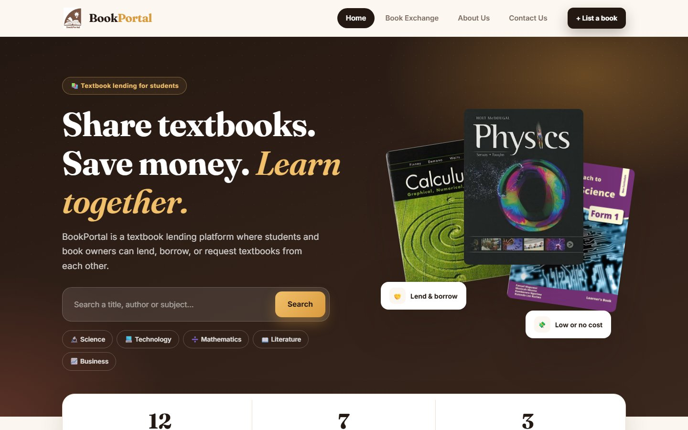
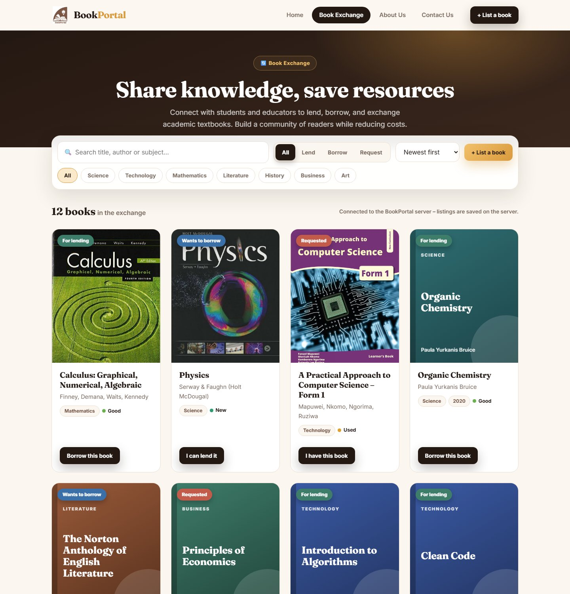
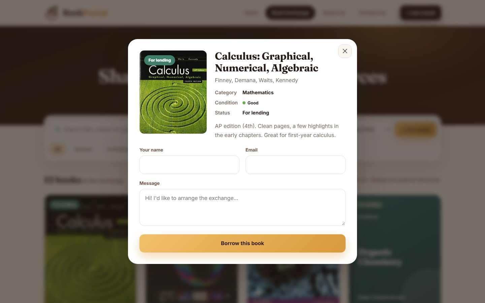
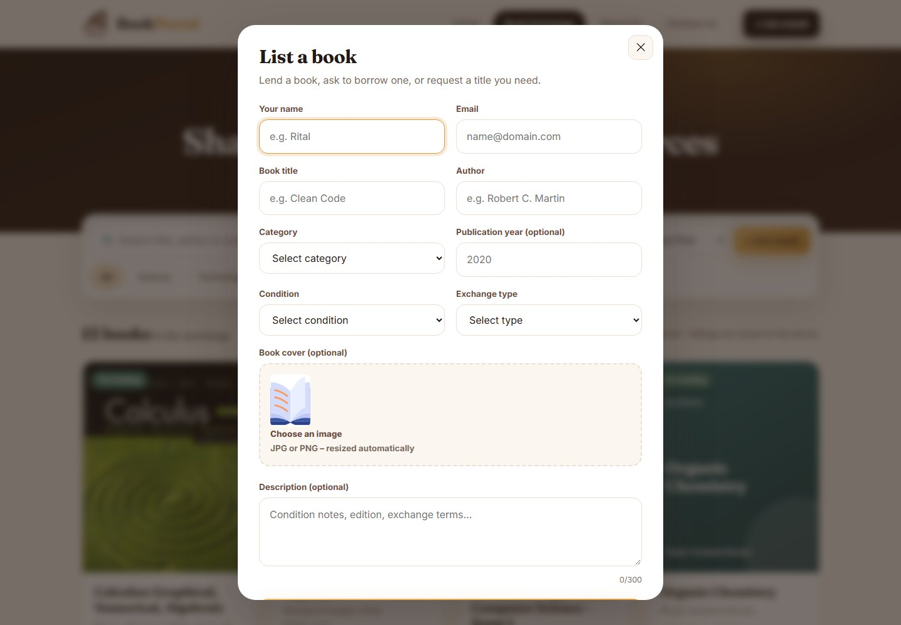
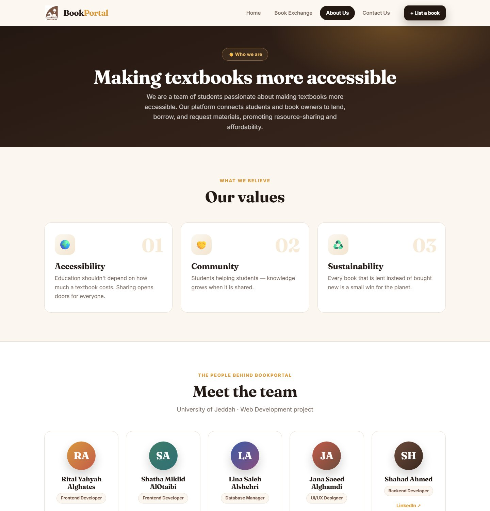
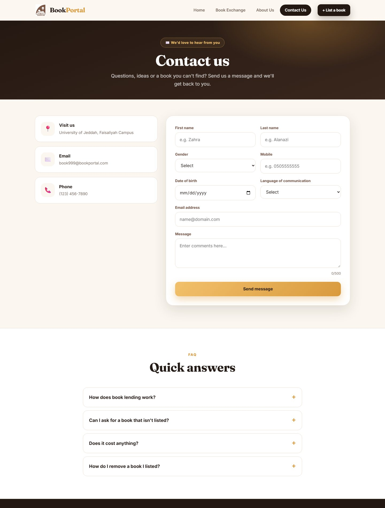
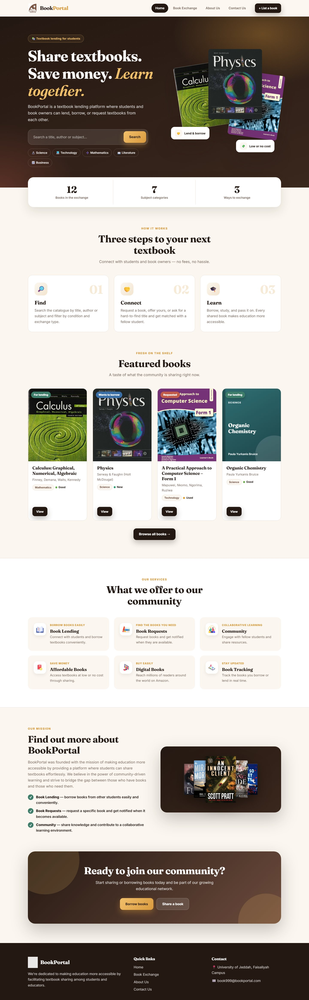
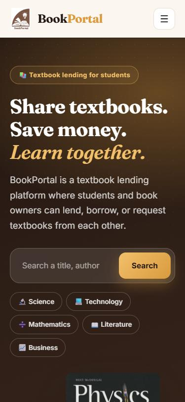
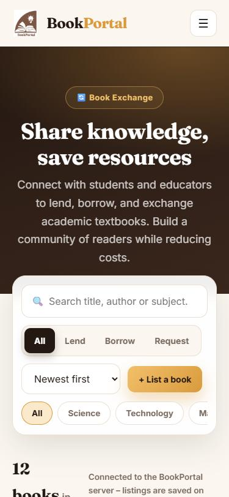
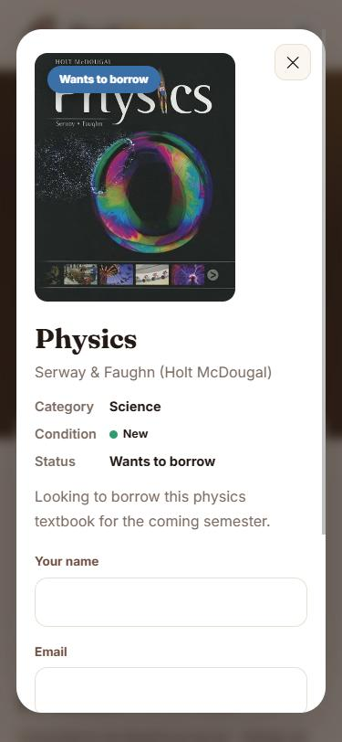

<div align="center">


# BookPortal

**Share textbooks. Save money. Learn together.**
A textbook lending and exchange platform where students and book owners can lend, borrow or request books from each other.

[**▶ Live demo**](https://ritalalghates.github.io/BookPortal/) · HTML · CSS · JavaScript · Node.js / Express




</div>

## ✨ Features

- **Interactive book exchange** – a live catalogue with search, category chips, exchange-type filter (Lend / Borrow / Request) and sorting
- **List a book** – a validated form (inline errors, success states, character counter) with **cover upload and preview**; your listing appears instantly and can be removed
- **Request a book** – every card opens a detail dialog with a request form for the owner
- **Smart covers** – real cover images where available, beautifully generated covers for the rest
- **Contact form** with live validation, FAQ accordion and recent-messages list
- **Polished UI** – warm "library" design system, serif display typography (Fraunces + Inter), scroll-reveal animations, animated counters, parallax book stack, toast notifications, scroll progress bar, back-to-top
- **Fully responsive** – mobile menu, flexible grids, tested at 375 px
- **Two ways to run**
  - **Static / demo mode** (GitHub Pages) – listings and messages are saved in the browser's `localStorage`
  - **Server mode** (`npm start`) – the same UI talks to an Express JSON API and saves to `data/store.json`; no database setup needed
- **Accessible basics** – semantic landmarks, ARIA labels, keyboard support (Esc closes dialogs), reduced-motion support

## 🖼️ Screens

<table>
  <tr>
    <td width="50%"><b>Book exchange</b><br></td>
    <td width="50%"><b>Book details & request</b><br></td>
  </tr>
  <tr>
    <td><b>List a book</b><br></td>
    <td><b>About & team</b><br></td>
  </tr>
  <tr>
    <td colspan="2"><b>Contact</b><br></td>
  </tr>
</table>

### Home page (full)

<p align="center"></p>

### 📱 On mobile

<p align="center">
  
  
  
</p>

## 🚀 Run it

**Quick look (no install)** – open `index.html` in a browser, or serve the folder:

```bash
python -m http.server 8000     # http://localhost:8000
```

**With the Express server**

```bash
npm install
npm start                      # http://localhost:3000
```

The page shows which mode it is in ("Connected to the BookPortal server" or "Demo mode"). Server data lives in `data/store.json` (git-ignored).

### API

| Method | Endpoint | Purpose |
| --- | --- | --- |
| GET | `/api/health` | Server detection |
| GET / POST | `/api/books` | List / add a book listing (validated) |
| DELETE | `/api/books/:id` | Remove a listing |
| POST | `/api/contact` | Contact form (same validation rules as the original project) |
| GET | `/api/contact` | Recent messages (first name, email and time only) |
| POST | `/api/requests` | Request a book from its owner |

## 🗂️ Project structure

```text
index.html        Home
exchange.html     Book exchange (catalogue, filters, dialogs)
about.html        About us and team
contact.html      Contact form and FAQ
assets/
├── css/styles.css   Design system
├── js/app.js        Layout, toast, storage layer (API / localStorage), home page
├── js/exchange.js   Catalogue, search / filters, listing form, request dialog
├── js/contact.js    Contact form validation and messages
├── js/data.js       Starter catalogue
└── img/             Logo, icons and book covers
server.js         Express server and JSON API
docs/             README screenshots
```

## 👩‍💻 Team

BookPortal began as a Web Development course project at the **University of Jeddah** by:

| Name | Role |
| --- | --- |
| Rital Yahyah Alghates | Frontend Developer |
| Shatha Miklid AlOtaibi | Frontend Developer |
| Lina Saleh Alshehri | Database Manager |
| Jana Saeed Alghamdi | UI/UX Designer |
| Shahad Ahmed | Backend Developer |

This version is a redesign and extension of that project: a new design system, an interactive catalogue, a
database-free server and a static demo mode. The original team repository is
[lenaS7/BookPortal-webdev](https://github.com/lenaS7/BookPortal-webdev).

## ℹ️ Notes

- Starter books are demo content; textbook covers are shown for illustration.
- Demo mode stores data only in your own browser, so nothing you enter leaves your device.
